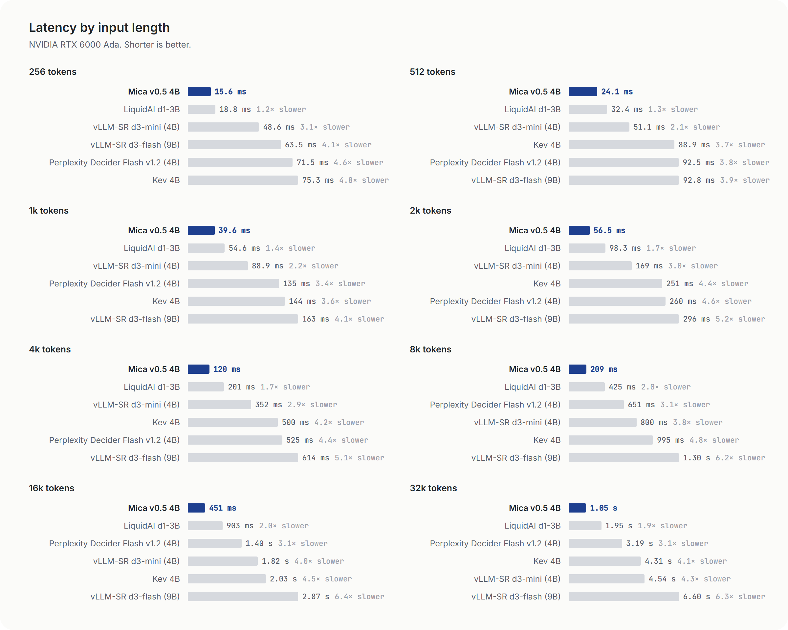
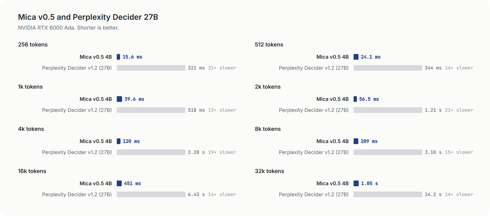
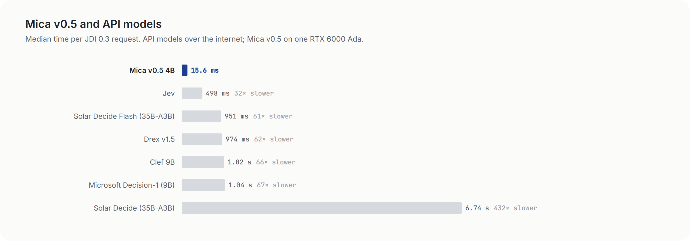

<p align="center">
  <a href="https://huggingface.co/sky7350/Mica-v0.5-4B"><b>Model card</b></a> &nbsp;·&nbsp;
  <a href="#speed"><b>Speed</b></a> &nbsp;·&nbsp;
  <a href="#quick-start"><b>Quick start</b></a> &nbsp;·&nbsp;
  <a href="#api"><b>API</b></a> &nbsp;·&nbsp;
  <a href="#choose-a-file"><b>Choose a file</b></a> &nbsp;·&nbsp;
  <a href="#configuration"><b>Configuration</b></a> &nbsp;·&nbsp;
  <a href="https://ko-fi.com/micakiv"><b>Ko-fi</b></a>
</p>

<p align="center">Looking forward to v1.0? A small donation on <a href="https://ko-fi.com/micakiv">Ko-fi</a> would mean a lot. I'm just a broke student, and I need your help.</p>

Mica is a 4B model for making decisions inside software. Send it the material a decision depends on, the questions
you need answered and the answers you allow; it returns a probability for every answer. No text is generated, so the
cost of a decision is one read of the input.

This repository is the HTTP server for **Mica v0.5 4B**. It runs the INT8 weights on the CUDA runtime, or the GGUF weights on llama.cpp, on one GPU.

- **Option order does not move it.** Shuffle the allowed answers and it picks the same one 97.3% of the time.
- **It can hold back.** Set `abstain_threshold` and it flags the cases it is not sure about instead of guessing.
- **Score questions take 2–255 levels**, choice questions up to 255 options, inputs up to 32k tokens.

| 4B | 32,768 | 2–255 | 0 | EN · KO · ZH | Apache-2.0 |
|:---:|:---:|:---:|:---:|:---:|:---:|
| parameters | input tokens | options or score levels | tokens generated | main languages | license |

## Results


| Model | Size | JDI 0.3 | JevBench Hard |
|---|:---:|:---:|:---:|
| PPLX Decider Flash | 4B | 60.1 | — |
| Jev | ~100B | 59.1 | 80/111 |
| **Mica v0.5** | 4B | **58.8** | **84/111** |
| CoCo Decision | 4B | 55.4 | — |
| d3-mini | 4B | 54.9 | 68/111 |
| OneJev 1.5 | 4B | 54.9 | — |
| MS Decision-1 | 9B | 54.7 | 91/111 |
| Clef | 9B | 53.0 | 72/111 |
| RSI-Jev 6.1 | 4B | 51.0 | — |
| d1 | 3B | 49.0 | 60/111 |
| Kev | 4B | 39.1 | 60/111 |
| Mica v0.1 | 4B | 37.2 | 72/111 |
| Solar Decide | 35B | 36.7 | 82/111 |
| Solar Decide Flash | 35B | 23.1 | 68/111 |
| d3-flash | 9B | — | 70/111 |
| Imajev | 4B | — | 80/111 |

Same items and scoring for every model; other models are our runs.

## Speed







Measured on one NVIDIA RTX 6000 Ada with the INT8 CUDA runtime. Per-task latency and more options are on the
[model card](https://huggingface.co/sky7350/Mica-v0.5-4B#speed).

## Quick start

### CUDA runtime (INT8, NVIDIA GPUs with 8 GB or more)

Linux (or WSL2 on Windows), CUDA 12, Python 3.10 to 3.13:

```bash
git clone https://github.com/akivet/Mica && cd Mica
python3 -m venv .venv && . .venv/bin/activate
pip install -r v0.5/serving/requirements.txt
pip install --no-build-isolation causal-conv1d==1.7.0
python v0.5/serving/serve.py
```

Windows (experimental), Python 3.10 to 3.13, an NVIDIA driver for CUDA 12.8, in PowerShell:

```powershell
git clone https://github.com/akivet/Mica; cd Mica
py -3.12 -m venv .venv; .venv\Scripts\Activate.ps1
pip install -r v0.5/serving/requirements-windows.txt
python v0.5/serving/serve.py
```

PyTorch's Windows builds have no FlashAttention kernel, so the Windows runtime brings its own precompiled attention
kernel; on a Linux GPU set up the same way it stays within 1-12% of the Linux latency (256 to 32k tokens) with the
same accuracy. It has not run on a Windows PC yet: if the start line says `bfloat16` or requests are slow, run the
Linux commands above in WSL2.

INT8 runs on compute capability 8.0 and newer (RTX 30/40/50 series, RTX A-series and Ada workstation cards, L4, L40S,
A100, H100, H200, B200); other GPUs fall back to bfloat16 by themselves. The first start downloads the INT8 weights (about
4.9 GB) into `--state-dir` (default `~/.cache/mica_runtime`; `--model` points at weights you already have), loads the kernel settings shipped for common GPUs (`--kernel-tune pinned`, the default; `full` tunes every kernel on this GPU instead), printing each stage, and saves its state there. The server answers as soon as it prints `Ready`; CUDA graphs are then captured in the background while it is idle, and until they are ready a request can wait up to about 0.7 s. On a GPU without shipped settings it starts with the closest GPU's settings and, after 30 s idle, tunes one kernel at a time for this GPU and saves the result. On an RTX 6000 Ada the first start takes about 25–35 s after the download and later starts with the same `--state-dir` about 14 s, so keep `--state-dir` on a persistent disk. Kernel compilation is CPU-bound, so a host whose CPU is shared and fully loaded starts much more slowly. The longest input is
set from the GPU's memory (the GPU table lists it). For bfloat16 from the full weights, download
`model.safetensors*`, `*.json`, `*.jinja` and `*.txt` and run with `--model weights --w8a8 off`.

### Docker (GGUF, llama.cpp)

```bash
git clone https://github.com/akivet/Mica && cd Mica
docker build -t mica .
docker run --gpus all -p 8010:8010 -v mica-weights:/weights mica
```

The first start downloads `mica-v0.5-4b-Q8_0.gguf` and the tokenizer into the `mica-weights` volume. For a smaller GPU
pick a file from [Choose a file](#choose-a-file) and pass it as `-e MICA_GGUF=...`. The image is built for CUDA
architectures 86, 89 and 90 (RTX 30xx, RTX 40xx and L40S, H100); pass `--build-arg CUDA_ARCH=...` for others.
The image is for NVIDIA GPUs; for AMD, Intel or Apple use the steps below.

### Without Docker (GGUF, llama.cpp)

Linux or macOS, Python 3.10 or newer. The Python side only renders prompts and tokenizes, so `requirements.txt` is
about 30 MB (no PyTorch). `BACKEND` picks the GPU API: `cuda` (default), `vulkan` (AMD, Intel),
`hip` (AMD with ROCm) or `metal` (Apple):

```bash
pip install -r requirements.txt
BACKEND=cuda bash scripts/build_runtime.sh   # builds llama.cpp into ./runtime
hf download sky7350/Mica-v0.5-4B mica-v0.5-4b-Q8_0.gguf \
   tokenizer.json tokenizer_config.json chat_template.jinja config.json --local-dir weights
bash scripts/serve.sh                        # http://127.0.0.1:8010/v1/systemone
```

`llama-server -m mica-v0.5-4b-Q8_0.gguf` loads the file but answers `/v1/systemone` with 501 "This model is not a
decision model": llama-server only serves the decision models it has a built-in readout for, and Mica is not one of
them. This server reads Mica's answers itself and uses llama.cpp as a library, so a llama.cpp you have already built
works too: point `--runtime` at the directory that holds `libllama.so` (`build/bin` of a CMake build with shared
libraries, b11010, or b11700 and later) instead of running `build_runtime.sh`:

```bash
python -m mica.server --gguf weights/mica-v0.5-4b-Q8_0.gguf --hf weights --runtime ~/llama.cpp/build/bin \
  --calibration calibration.json --port 8010
```

Windows with any GPU (AMD, Intel or NVIDIA) through Vulkan, Python 3.10 or newer, in PowerShell:

```powershell
git clone https://github.com/akivet/Mica; cd Mica
py -3.12 -m venv .venv; .venv\Scripts\Activate.ps1
pip install -r requirements.txt
Invoke-WebRequest https://github.com/ggml-org/llama.cpp/releases/download/b11700/llama-b11700-bin-win-vulkan-x64.zip -OutFile llama.zip
Expand-Archive llama.zip runtime
# optional, faster: the same two DLLs built with scripts/patches (long-input mode and the Vulkan patch)
foreach ($f in 'llama.dll', 'ggml-vulkan.dll') { Invoke-WebRequest https://github.com/akivet/Mica/releases/download/b11700-r2/$f -OutFile runtime\$f }
hf download sky7350/Mica-v0.5-4B mica-v0.5-4b-Q8_0.gguf tokenizer.json tokenizer_config.json chat_template.jinja config.json --local-dir weights
python -m mica.server --gguf weights\mica-v0.5-4b-Q8_0.gguf --hf weights --runtime runtime --calibration calibration.json --n-ctx 8192 --seqs 2
```

On an 8 GB card keep `--n-ctx 8192 --seqs 2` (each sequence, plus one for the state cache, holds `--n-ctx` tokens of
attention memory). Measured on an AMD RX 6600 XT through Vulkan, first request on a state:

| State | Official DLLs | Patched `ggml-vulkan.dll` | Both patched DLLs (long-input mode) |
|---|---|---|---|
| short | 0.4 s | 0.4 s | 0.4 s |
| 1k tokens | 1.1 s | 1.0 s | 0.74 s |
| 2k tokens | - | 1.9 s | 1.3 s |
| 4k tokens | 4.2 s | 3.6 s | 2.4 s |

The Vulkan patch tiles the concat that feeds the linear-attention layers (all GPUs) and widens the int8 matmul tile on
RX 6000 cards with AMD's driver (`GGML_VK_RDNA2_TUNE=0` turns that off); its probabilities are the official build's.
Long-input mode (`scripts/patches/long-input-b11700.patch`, any backend; Linux builds from `build_runtime.sh` and the
Docker image include it) is the same path as the Hugging Face runtime's for prompts over 1k tokens: the state rows run
the lower 16 layers, and the upper 16 only build what later rows read from them (attention K/V and the linear-attention
state); the last 128 state tokens and the question run every layer. On 149 evaluation prompts over 1k tokens it was
1.33x (1-2k) to 1.56x (8-16k) faster, answered 112 correctly against 113 exactly, and gave the same answer on 144.
Shorter prompts are unchanged; `--long-input off` runs every row exactly. Flash attention is off by default on Vulkan
builds; on that card it doubled the time of a 4k-token request. With `--state-cache` (on by default), a second question
about the same ~3.7k-token state took 0.11-0.16 s instead of 3.7 s (0.23-0.26 s in long-input mode, which recomputes the
last 128 state tokens), and the same transcript grown by 500 tokens about 0.6 s instead of 4.2 s.

## API

`POST /v1/systemone`

```bash
curl -s localhost:8010/v1/systemone -H 'Content-Type: application/json' -d '{
  "state": {"order": 4471, "paid": 129.00, "refund_requested": 129.00, "delivered": false,
            "carrier_note": "Package returned to sender: address not found"},
  "questions": {
    "refund":   {"type": "noul", "instructions": "Should the full refund be approved automatically?"},
    "priority": {"type": "score", "instructions": "How urgent is this ticket?",
                 "criteria": ["Can wait", "Today", "Within the hour"]}
  }}'
```

```json
{
  "model": "mica-v0.5-4b",
  "answers": {
    "refund":   {"type": "noul", "noul": 0.91},
    "priority": {"type": "score", "score": 1.12, "level": 1, "expected_level": 1.12,
                 "probabilities": {"0": 0.12, "1": 0.64, "2": 0.24},
                 "legend": {"0": "Can wait", "1": "Today", "2": "Within the hour"},
                 "confidence": 0.71, "margin": 0.40}
  },
  "usage": {"input_tokens": 168, "output_tokens": 0},
  "latency_ms": 41.7
}
```

The values show the response shape only.

| Type | `criteria` | Result |
|---|---|---|
| `noul` | Optional `{"false": "...", "true": "..."}` | `noul`: probability of true |
| `choice` | `{"id": "description", ...}`, 2–255 options | `choice`, `probabilities`, `confidence` |
| `score` | `["lowest level", ..., "highest level"]`, 2–255 levels | `level`, `expected_level`, `probabilities` |

Optional per question: `"multi": true` (choice with several correct options), `"allow_cannot_grade": true` (score),
`"abstain_threshold": <0..1>` (any type). Questions in one request share a single pass over the state; on an RTX 6000 Ada a 1k-token state with 4 questions takes about 70 ms. Inputs over 32,768 tokens and malformed requests get HTTP 400 with a message;
nothing is truncated.

`GET /health` returns `{"status": "ok", "model": ...}`, plus `graphs_ready`, `graphs_queued` and `warming` while CUDA graphs are being captured. A rejected request (400) says why in `detail`.

For how to write the state, the rule and the answers, and recipes for security, engineering, moderation,
search and routing decisions, see the [prompting guide](https://huggingface.co/sky7350/Mica-v0.5-4B#prompting-guide).

## Choose a file

| GPU memory | For example | Recommended file | Longest input | Accuracy vs BF16 |
|---|---|---|:---:|:---:|
| 24 GB and up | RTX 3090, 4090, 5090 | INT8 · CUDA runtime | 32k | same |
| 16 GB | RTX 4060 Ti 16 GB, 5060 Ti | INT8 · CUDA runtime | 27k | same |
| 12 GB | RTX 3060 12 GB, 4070 | INT8 · CUDA runtime | 12k | same |
| 8 GB | RTX 3070, 4060 | INT8 · CUDA runtime | 6k | same |
| AMD, Intel, Apple, CPU | RX 7900, Arc, M-series | `mica-v0.5-4b-Q8_0.gguf` (GGUF, without Docker) | — | -0.2 pt |

All files are in [sky7350/Mica-v0.5-4B](https://huggingface.co/sky7350/Mica-v0.5-4B/tree/main).

## Configuration

Docker environment variables:

| Variable | Default | |
|---|---|---|
| `MICA_GGUF` | `mica-v0.5-4b-Q8_0.gguf` | Weights file to download and serve |
| `MICA_REPO` | `sky7350/Mica-v0.5-4B` | Hugging Face repository |
| `MICA_REVISION` | `main` | Repository revision |
| `PORT` | `8010` | Listening port |

Server flags (`python -m mica.server --help`):

| Flag | Default | |
|---|---|---|
| `--n-ctx` | `32768` | Longest accepted input, in tokens |
| `--seqs` | `8` | Questions decoded side by side on one input; more are handled in groups of this size |
| `--flash-attn` | `-1` | `-1` auto (off on Vulkan builds), `0` off, `1` on |
| `--n-ubatch` | `512` | Tokens per prefill step on the GPU |
| `--state-cache` | `on` | Keep the latest long state on the GPU: asking again about the same state, or a state that grew (an agent transcript), decodes only the new tokens. Costs one more sequence of `--n-ctx` |
| `--long-input` | `on` | Faster path for prompts over 1k tokens on builds with the long-input patch (others run exactly) |
| `--calibration` | `calibration.json` | Temperature applied to the probabilities |

## Tests

```bash
python -m pytest tests
```

The tests check request parsing, prompt rendering and response shapes against fixed cases. They need the tokenizer
files but no GPU.

## Earlier versions

The v0.1 4B server is kept at tag [`v0.1.2`](https://github.com/akivet/Mica/tree/v0.1.2), with its weights at
[sky7350/Mica-v0.1-4B](https://huggingface.co/sky7350/Mica-v0.1-4B).

## License

Apache-2.0. The model is a fine-tune of Qwen/Qwen3.5-4B (Apache-2.0). llama.cpp (MIT) is built locally and not
redistributed. See `NOTICE`.
