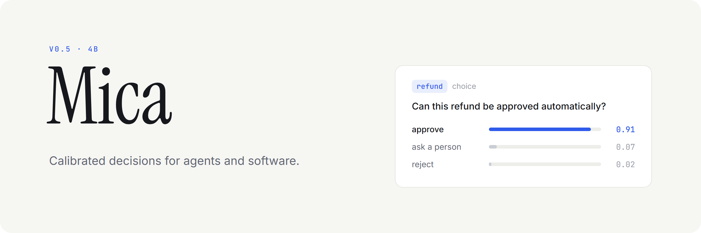
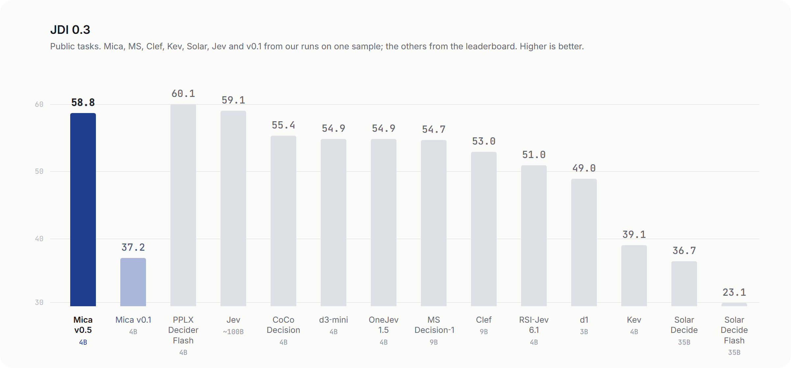
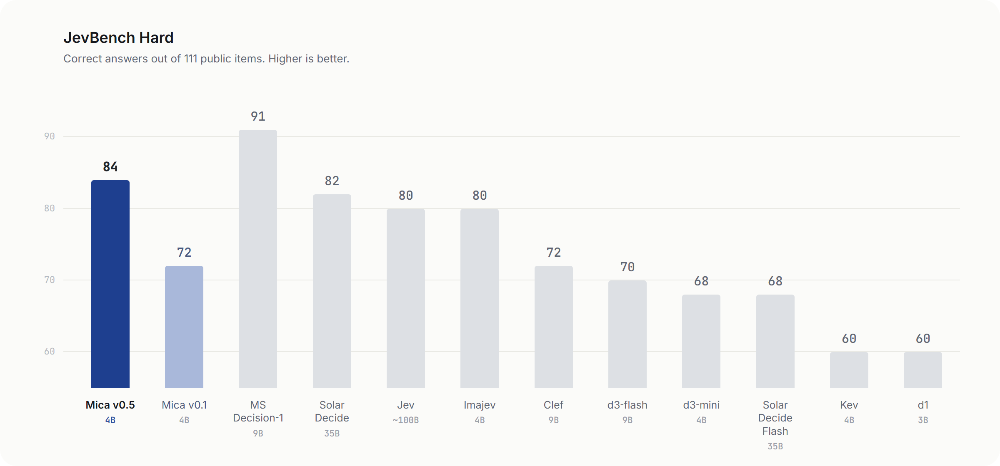
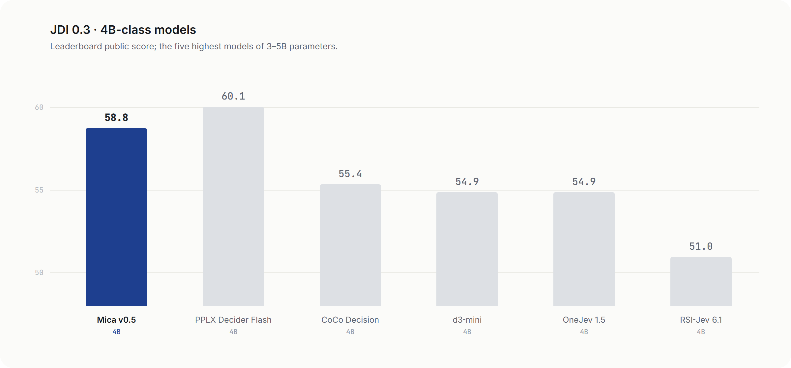
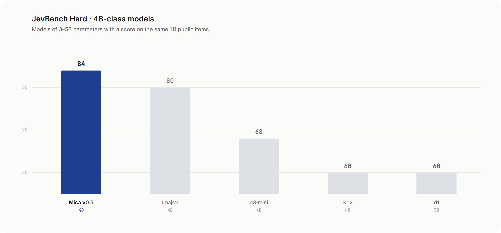

<p align="center">
  <a href="https://huggingface.co/sky7350/Mica-v0.5-4B"><b>Model card</b></a> &nbsp;·&nbsp;
  <a href="#quick-start"><b>Quick start</b></a> &nbsp;·&nbsp;
  <a href="#api"><b>API</b></a> &nbsp;·&nbsp;
  <a href="#choose-a-file"><b>Choose a file</b></a> &nbsp;·&nbsp;
  <a href="#configuration"><b>Configuration</b></a>
</p>

Mica is a 4B model for making decisions inside software. Send it the material a decision depends on, the questions
you need answered and the answers you allow; it returns a probability for every answer. No text is generated, so the
cost of a decision is one read of the input.

This repository is the HTTP server for **Mica v0.5 4B**. It runs the GGUF weights through llama.cpp on one GPU.

| 4B | 32,768 | 2–255 | 0 | EN · KO · ZH | Apache-2.0 |
|:---:|:---:|:---:|:---:|:---:|:---:|
| parameters | input tokens | options or score levels | tokens generated | main languages | license |

## Results









| Model | Size | JDI 0.3 | JevBench Hard |
|---|:---:|:---:|:---:|
| PPLX Decider Flash | 4B | 60.1 | — |
| Jev | ~100B | 59.1 | 80/111 |
| **Mica v0.5** | 4B | **58.8** | **84/111** |
| CoCo Decision | 4B | 55.4 | — |
| d3-mini | 4B | 54.9 | 68/111 |
| OneJev 1.5 | 4B | 54.9 | — |
| MS Decision-1 | 9B | 54.7 | 91/111 |
| Clef | 9B | 53.0 | 72/111 |
| RSI-Jev 6.1 | 4B | 51.0 | — |
| d1 | 3B | 49.0 | 60/111 |
| Kev | 4B | 39.1 | 60/111 |
| Mica v0.1 | 4B | 37.2 | 72/111 |
| Solar Decide | 35B | 36.7 | 82/111 |
| Solar Decide Flash | 35B | 23.1 | 68/111 |
| d3-flash | 9B | — | 70/111 |
| Imajev | 4B | — | 80/111 |

Same items and scoring for every model; other models are our runs. Per-GPU speed numbers
are on the [model card](https://huggingface.co/sky7350/Mica-v0.5-4B#results).

## Quick start

### Docker

```bash
git clone https://github.com/akivet/Mica && cd Mica
docker build -t mica .
docker run --gpus all -p 8010:8010 -v mica-weights:/weights mica
```

The first start downloads `mica-v0.5-4b-Q8_0.gguf` and the tokenizer into the `mica-weights` volume. For a smaller GPU
pick a file from [Choose a file](#choose-a-file) and pass it as `-e MICA_GGUF=...`. The image is built for CUDA
architectures 86, 89 and 90 (RTX 30xx, RTX 40xx and L40S, H100); pass `--build-arg CUDA_ARCH=...` for others.

### Without Docker

Linux, CUDA 12, Python 3.10 or newer:

```bash
pip install -r requirements.txt
bash scripts/build_runtime.sh        # builds llama.cpp into ./runtime
hf download sky7350/Mica-v0.5-4B mica-v0.5-4b-Q8_0.gguf \
   tokenizer.json tokenizer_config.json chat_template.jinja config.json --local-dir weights
bash scripts/serve.sh                # http://127.0.0.1:8010/v1/systemone
```

## API

`POST /v1/systemone`

```bash
curl -s localhost:8010/v1/systemone -H 'Content-Type: application/json' -d '{
  "state": {"order": 4471, "paid": 129.00, "refund_requested": 129.00, "delivered": false,
            "carrier_note": "Package returned to sender: address not found"},
  "questions": {
    "refund":   {"type": "noul", "instructions": "Should the full refund be approved automatically?"},
    "priority": {"type": "score", "instructions": "How urgent is this ticket?",
                 "criteria": ["Can wait", "Today", "Within the hour"]}
  }}'
```

```json
{
  "model": "mica-v0.5-4b",
  "answers": {
    "refund":   {"type": "noul", "noul": 0.91},
    "priority": {"type": "score", "score": 1.12, "level": 1, "expected_level": 1.12,
                 "probabilities": {"0": 0.12, "1": 0.64, "2": 0.24},
                 "legend": {"0": "Can wait", "1": "Today", "2": "Within the hour"},
                 "confidence": 0.71, "margin": 0.40}
  },
  "usage": {"input_tokens": 168, "output_tokens": 0},
  "latency_ms": 41.7
}
```

The values show the response shape only.

| Type | `criteria` | Result |
|---|---|---|
| `noul` | Optional `{"false": "...", "true": "..."}` | `noul`: probability of true |
| `choice` | `{"id": "description", ...}`, 2–255 options | `choice`, `probabilities`, `confidence` |
| `score` | `["lowest level", ..., "highest level"]`, 2–255 levels | `level`, `expected_level`, `probabilities` |

Optional per question: `"multi": true` (choice with several correct options), `"allow_cannot_grade": true` (score),
`"abstain_threshold": <0..1>` (any type). Inputs over 32,768 tokens and malformed requests get HTTP 400 with a message;
nothing is truncated.

`GET /health` returns `{"status": "ok", "model": ...}`.

For how to write the state, the rule and the answers, and recipes for security, engineering, moderation,
search and routing decisions, see the [prompting guide](https://huggingface.co/sky7350/Mica-v0.5-4B#prompting-guide).

## Choose a file

| GPU memory | For example | Recommended file | Longest input | Accuracy vs BF16 |
|---|---|---|:---:|:---:|
| 24 GB and up | RTX 3090, 4090, 5090 | INT8 · CUDA runtime | 32k | same |
| 16 GB | RTX 4060 Ti 16 GB, 5060 Ti | INT8 · CUDA runtime | 27k | same |
| 12 GB | RTX 3060 12 GB, 4070 | `mica-v0.5-4b-Q8_0.gguf` | — | -0.2 pt |
| 8 GB | RTX 3070, 4060 | `mica-v0.5-4b-IQ4_XS.gguf` | — | -0.4 pt |

All files are in [sky7350/Mica-v0.5-4B](https://huggingface.co/sky7350/Mica-v0.5-4B/tree/main).

## Configuration

Docker environment variables:

| Variable | Default | |
|---|---|---|
| `MICA_GGUF` | `mica-v0.5-4b-Q8_0.gguf` | Weights file to download and serve |
| `MICA_REPO` | `sky7350/Mica-v0.5-4B` | Hugging Face repository |
| `MICA_REVISION` | `main` | Repository revision |
| `PORT` | `8010` | Listening port |

Server flags (`python -m mica.typesafe_server --help`):

| Flag | Default | |
|---|---|---|
| `--n-ctx` | `32768` | Longest accepted input, in tokens |
| `--seqs` | `8` | Questions decoded side by side on one input; more are handled in groups of this size |
| `--flash-attn` | `-1` | `-1` auto, `0` off (faster on some Vulkan GPUs), `1` on |
| `--calibration` | `calibration.json` | Temperature applied to the probabilities |

## Tests

```bash
python -m pytest tests
```

The tests check request parsing, prompt rendering and response shapes against fixed cases. They need the tokenizer
files but no GPU.

## Earlier versions

The v0.1 4B server is kept at tag [`v0.1.2`](https://github.com/akivet/Mica/tree/v0.1.2), with its weights at
[sky7350/Mica-v0.1-4B](https://huggingface.co/sky7350/Mica-v0.1-4B).

## License

Apache-2.0. The model is a fine-tune of Qwen/Qwen3.5-4B (Apache-2.0). llama.cpp (MIT) is built locally and not
redistributed. See `NOTICE`.
